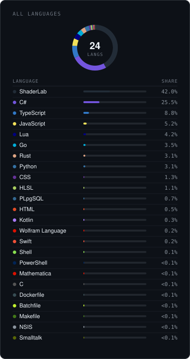
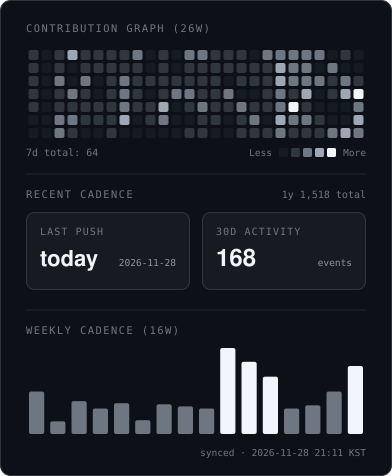

  <h1>HanJoo Kim</h1>
  
<samp>AI Engineering · Virtual Streaming · Unity 3D · Data</samp>

  
Exploring where generative AI, 3D worlds, and Virtual Streaming meet.

 

  <picture>
    <source media="(prefers-color-scheme: dark)" srcset="./assets/lang-dark.svg" />
    <source media="(prefers-color-scheme: light)" srcset="./assets/lang-light.svg" />
    
  </picture>
  &nbsp;
  <picture>
    <source media="(prefers-color-scheme: dark)" srcset="./assets/activity-dark.svg" />
    <source media="(prefers-color-scheme: light)" srcset="./assets/activity-light.svg" />
    
  </picture>

 

  <a href="mailto:sevendays5252@gmail.com">
    <picture>
      <source media="(prefers-color-scheme: dark)" srcset="./assets/btn-email-dark.svg" />
      <source media="(prefers-color-scheme: light)" srcset="./assets/btn-email-light.svg" />
      
    </picture>
  </a>
  &nbsp;&nbsp;
  <a href="https://github.com/sevendays52?tab=repositories">
    <picture>
      <source media="(prefers-color-scheme: dark)" srcset="./assets/btn-repos-dark.svg" />
      <source media="(prefers-color-scheme: light)" srcset="./assets/btn-repos-light.svg" />
      
    </picture>
  </a>

