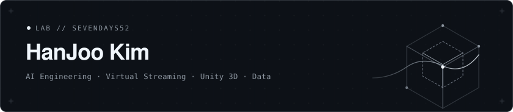
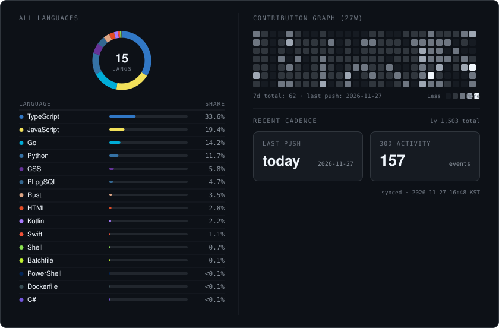
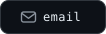
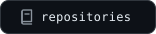

  <picture>
    <source media="(prefers-color-scheme: dark)" srcset="./assets/header-dark.svg" />
    <source media="(prefers-color-scheme: light)" srcset="./assets/header-light.svg" />
    
  </picture>

  
    Incoming M.S. Student · Exploring <b>AI Pipelines</b>, <b>Unity 3D Worlds</b>, <b>Virtual Streaming</b> &amp; <b>Data</b>.
  

 

  <picture>
    <source media="(prefers-color-scheme: dark)" srcset="./assets/stats-dark.svg" />
    <source media="(prefers-color-scheme: light)" srcset="./assets/stats-light.svg" />
    
  </picture>

 

  <a href="mailto:sevendays5252@gmail.com">
    <picture>
      <source media="(prefers-color-scheme: dark)" srcset="./assets/btn-email-dark.svg" />
      <source media="(prefers-color-scheme: light)" srcset="./assets/btn-email-light.svg" />
      
    </picture>
  </a>
  &nbsp;&nbsp;
  <a href="https://github.com/sevendays52?tab=repositories">
    <picture>
      <source media="(prefers-color-scheme: dark)" srcset="./assets/btn-repos-dark.svg" />
      <source media="(prefers-color-scheme: light)" srcset="./assets/btn-repos-light.svg" />
      
    </picture>
  </a>

